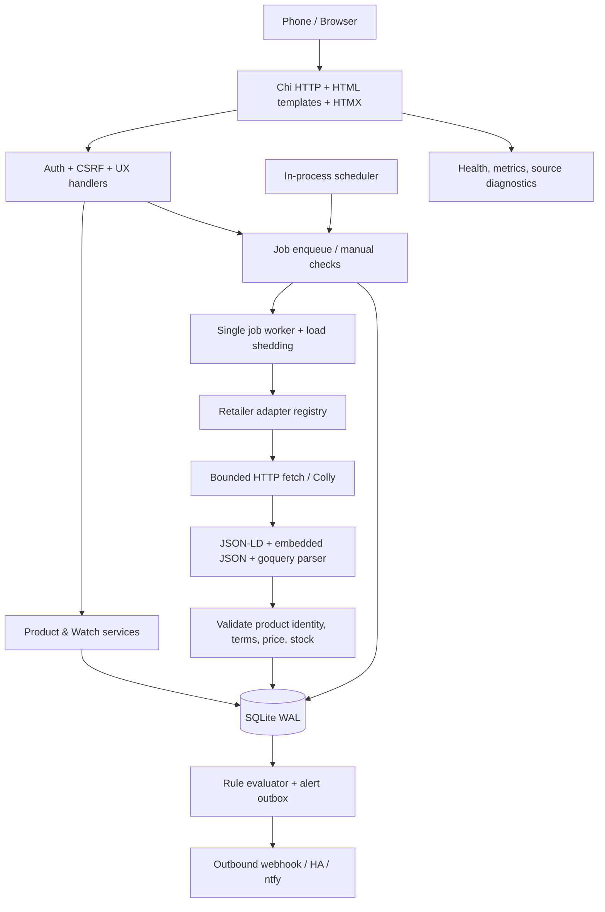

# leanPrice — Technical Architecture and Engineering Standard
**Baseline:** v1.1 design contract; local implementation is in progress, external source and Pi certification gates remain open | **Reviewed:** 2026-10-19 | **Authored after product merge:** `15c53baff00a7eaffa028ceb5e9d73938fb6ff28`  
**Product source of truth:** [PRD](../product/PRD.md), [UX](../product/UX-SPEC.md), [Acceptance](../product/ACCEPTANCE.md)  
**Repository:** https://github.com/Onellan/leanPrice  
**Author perspective:** Principal/Senior Solutions Architect, Staff Go Engineer, Security Architect, UX Architect and SRE.

## 1. Context and architectural quality attributes
leanPrice is a household-scale South African retail price watcher running on a busy Raspberry Pi 4B (4GB RAM, ARM64). It must function with no compulsory external discovery service, no local headless browser and a verified **whole Pi-hosted leanPrice memory ceiling of 500,000,000 bytes**. This plan values correct offer semantics, resilience to retailer drift, low operational cost and deterministic recoverability ahead of raw scraping throughput.

**Architectural priorities (in order):** (1) bounded memory and no host destabilization, (2) correct/fail-closed pricing and matching, (3) secure and permitted retrieval, (4) durable jobs/alert dedupe, (5) excellent mobile UX, (6) ease of adding assessed retailer adapters, (7) throughput.

**Implementation prohibition:** do not transplant PriceBuddy code, run Selenium/SearXNG/Chromium locally, advertise unsupported retailers, or enable cloud scraping silently. All CI-equivalent checks run locally; do not add `.github/workflows/*` or depend on GitHub runners.

## 2. System boundary and high-level containers
One Linux ARM64 OCI image containing the Go binary, compiled HTML templates and prebuilt HTMX/Tailwind assets. One SQLite database on a Docker bind mount/named volume. The same process serves HTTP requests and schedules bounded background work. Optionally, an outbound HTTPS webhook/remote discovery provider is used **only after opt-in**. No persistent companion container.



**Logical runtime components:** web, authenticated admin, product catalog, source registry, discovery adapter, fetcher/extractors, identity matcher, price normalizer, scheduler/worker, watch/rule engine, notification outbox, SQLite store, ops/reporting. These are packages in **one** binary, not microservices.

## 3. Stack and dependency decisions
| Concern | Choice | Why / boundary |
|---|---|---|
| Language | Go stable version pinned by `go.mod` and toolchain | Small footprint, strong HTTP/concurrency, cross-compile ARM64 |
| Router | `go-chi/chi` | Lean idiomatic routing/middleware |
| Views | `html/template`, embedded via `//go:embed` | HTML escaping, server-first render |
| Interactivity | HTMX vendored/minified static asset, version pinned | No SPA or runtime JS build |
| Styling | Tailwind CLI at **build** time; CSS tree-shaken | No Node.js in production container |
| Storage | `database/sql` + `modernc.org/sqlite` (CGO-free) | One local transactional store, ARM64 |
| Scraping | `net/http` client, Colly only where crawling helps | Bound streaming and per-host rate; no browser |
| HTML | goquery on bounded bodies | CSS selectors and simple structure extraction |
| Structured data | `encoding/json` JSON-LD/known publicly exposed data | First extraction preference |
| Scheduling | In-process ticker + DB persisted next-run/lease | No cron or Redis required |
| Password | Argon2id with small bounded memory work factor | Adaptive hashing; cap login concurrency |
| Notifications | Generic HTTPS webhook first; HA/ntfy adapters later | No separate daemon |
| Logging | `log/slog` JSON + local diagnostics | Structured, redacted logs |
| Metrics | runtime/cgroup sampling + optional guarded `/metrics` | No mandatory Prometheus |
| Packaging | Multi-stage Docker (build x86/ARM64; deploy ARM64) | Final scratch/distroless or minimal Alpine after CA/tz tests |

**Current pins and implementation:** Go 1.27.2, Chi 5.5.0, HTMX 2.0.11 and Tailwind CLI/Tailwind CSS 4.3.0. SQLite schema version 4 includes backup/restore, authentication, centralized safe-fetch policy, deterministic extraction/matching/pricing, a one-worker durable scheduler, memory backpressure, watch evaluation/outbox with per-watch notification preference, source pause/approval-gated enable with audit, bounded keyset pagination for products/history/activity, and local product/watch workflows. Settings shows the current app cgroup reading; watch setup/edit includes a no-send validated-offer preview; product detail includes a bounded sampled price chart. No retailer adapter is approved or enabled. URL-add confirmation and webhook endpoint configuration remain incomplete; the configured webhook has an explicit test action. Independent UX/security reviews and actual Pi measurements remain open. See the [execution plan](../plans/IMPLEMENTATION-PLAN-EXECUTION.md) and [batch evidence](../evidence/).

Dependency updates require pinned versions, license report and local tests; versions not committed to this doc are not assumed. No npm scripts/container at runtime.

## 4. Modules and package boundaries
```text
cmd/leanprice/main.go
internal/
  app/                wiring, config, lifecycle, request context
  auth/               single-admin setup, sessions, CSRF
  httpui/             chi routes, full-page/HTMX handlers, templates
  catalog/            canonical products, listing memberships
  sources/            retailer registry, capability/terms governance
  discovery/          opt-in name search and candidate queue
  fetch/              HTTP client, URL safety, budgets, throttling
  extract/            JSON-LD, embedded JSON, HTML selectors, provenance
  retailers/          per-retailer adapters + fixture contracts
  match/              GTIN, brand, size, pack and deterministic confidence
  pricing/            integer cents, stock, promo and comparability
  watches/            target rules, versioned evaluation, alert episodes
  notify/             delivery outbox, webhook transports
  jobs/               SQLite queue, scheduler, leases, backpressure
  storage/            repositories, DB lifecycle, migrations, backups
  ops/                health, resource governor, source diagnostics
web/
  templates/          layouts, screens, HTMX partials
  static/             built CSS, pinned HTMX, small chart assets
  styles/             Tailwind input compiled only in the image build stage
migrations/
testdata/
  fixtures/           approved/sanitized retailer HTML and JSON
  golden/             expected price/match/notification states
scripts/              local build, test, security, soak, backup drills
docs/
  product/            committed product contract
  technical/          this architecture and execution plan
```

**Clean seams:** handlers never execute arbitrary SQL or scrape HTML; adapters never emit directly to alerts; pricing never fetches network; notification transport never evaluates prices; queue worker owns job state; each product/offer record is reconciled in short DB transactions. Interfaces live in consumer package, not an abstract framework.

**Suggested interfaces:**
```go
type RetailerAdapter interface {
    Metadata() AdapterMetadata
    ParseProduct(context.Context, FetchResult) (Extraction, error)
    Search(context.Context, SearchInput) ([]Candidate, error) // optional capability
}
type Fetcher interface {
    Fetch(context.Context, ApprovedURL, FetchBudget) (FetchResult, error)
}
type ProductMatcher interface {
    Evaluate(CanonicalProduct, Extraction) MatchDecision
}
type AlertTransport interface {
    Send(context.Context, AlertPayload) (ProviderReceipt, error)
}
```
Capability-specific separate interfaces may be preferable to a mandatory Search method; proof must show unsupported search does not require an empty stub.

## 5. Data consistency and SQLite operations
**One authoritative database.** Use migrations with `PRAGMA user_version` or a migrations table, foreign keys ON, WAL mode, `busy_timeout` and measured `synchronous=NORMAL` vs FULL durability trade-off. Default `MaxOpenConns(1)` initially to eliminate competing writers; tune only with justified local performance evidence. Never run long network operations inside SQL transactions; use short BEGIN IMMEDIATE write sections for claim/upsert/alert episode dedupe. Schema upgrades are forward-only; rollback means restoring a validated pre-upgrade backup with the prior application image, not applying unreviewed down migrations.

Product is distinct from retailer listing, observed price, structured promotional offer, alert rule, alert episode and delivery attempt. Use integer cents and rational quantity normalization; no float for monetary comparisons. Use UTC epoch milliseconds or RFC3339 in database consistently; render in local timezone. See [DATA-CONTRACTS.md](DATA-CONTRACTS.md).

**Canonical identity fields:** normalized brand, line/variant, quantity number/unit, units per pack, GTIN when known, optional category. **Retailer listing fields:** URL, normalized URL key, retailer ID, remote SKU, locality, parser identity. **Price observation:** record all extraction facts and status; “current best” is a query over valid non-stale observations, not a mutable free-form latest-price field. Optional denormalized latest observation references must be transactional.

**SQLite retention:** keep core observation events and alert evidence necessary for trustworthy history; adjustable retention on verbose diagnostics and transient discovery candidates. Configure WAL checkpoints off-peak and avoid vacuum during active requests. Backups via SQLite online backup or `VACUUM INTO` to an atomic destination; copying only `.db` while WAL active is **not** accepted.

## 6. Retrieval and extraction pipeline
Order per supported/approved source:
1. Validate source is enabled, assessed and allowed for the configured destination/locale.
2. Validate URL HTTPS, DNS/IP/scheme/port/redirect safety; block loopback, private, link-local, metadata endpoints and unapproved domains; mitigate DNS rebinding by connecting to validated IP(s) and rechecking redirects.
3. Acquire global + domain tokens, memory slot and job lease; defer on pressure or policy backoff.
4. Bounded `net/http` GET with conservative headers, `context.WithTimeout`, gzip handling with **decompressed** byte cap; disallow unbounded redirect chains. Colly may orchestrate allowed links/rate limits but must call the hardened transport and respect the same limits.
5. Prefer JSON-LD `Product` / `Offer`; then documented site-specific embedded JSON; then page HTML with goquery selectors. Never eval JavaScript or access non-public unauthorized endpoints.
6. Emit normalized `Extraction` with per-field origin/path, sanitized source URL, fetch timestamp, source-content digest, adapter/parser version, size/brand/variant/GTIN, offer terms, stock and confidence; reject conflicting/highly suspicious price data. Keep the response body bounded and ephemeral; do not persist full raw pages by default.
7. Match product, validate currency/quantity, classify offer eligibility, persist observation/status.
8. Rule engine evaluates only **fresh exact-match qualifying observations**; transactional episode dedupe and outbox record.
9. Delivery worker sends bounded webhook with retry/idempotency and event trail.

**Fallback failures:** if structured data disagrees with clearly identified visible product data, classify as conflict and put into review; do not always select “cheapest.” If a page requires JS or signed-in state, mark unsupported or optionally invoke a separately hosted *remote* renderer following policy, never launch Chromium on the Pi.

### Default budgets (all configurable but product limits not bypassable)
- Max one worker lease processing a fetch at a time for MVP; at most two total controlled outbound HTTP connections, with no more than one fetch and one notification delivery in flight.
- Per-domain token bucket baseline **1 request / 10 s** and concurrency 1; obey stricter site terms, 429 `Retry-After` and exponential backoff.
- Request timeout 10–15 s; total operation 30 s; at most two retry attempts per scheduled episode.
- Max decompressed response size initially **2 MiB**, JSON-LD block 128 KiB, max search candidates 50/query and 10 pages/query for approved sources; reject oversized responses before goquery DOM allocation.
- Max redirect hops 3, only approved hostnames, no cookies tied to retailer login.
- Product matching is deterministic; candidate cap and fixture coverage precede fuzzy algorithms.
- Scheduling jitter, source-specific daily cap and bounded queue length; display deferred state rather than spinning.

These are architecture starting defaults; local ARM64 memory and source-policy tests decide reductions. Never raise concurrency to hide rate limits.

## 7. Search and discovery architecture
**R1:** manual submission of a URL from an assessed, approved and enabled source, plus local catalog search; manual submission never bypasses source approval or URL safety. Remote discovery is *not* necessary to operate.  
**R2:** search provider interface:
- `RetailerSearch` for explicitly validated site's permitted public search endpoint/page.
- Optional `RemoteDiscovery` for a user-configured commercial/search API with credentials and quota, using HTTPS and explicit privacy disclosure.
- Deduplicate by normalized retailer URL and canonical candidate fingerprint; label candidate “unverified” until successful product-page extraction.
- No general-purpose crawler that follows unlimited links. Discovery is a request-bounded workflow and must not monopolize UI or queue.
- Unsupported/no-permission source is not attempted; never use an anti-bot circumvention technique.

No SearXNG or local headless browser is bundled. Remote rendering outside Pi remains a future capability with external trust/cost documentation.

## 8. Matching and pricing domain rules
**Match pipeline:** normalize Unicode/case/space → parse brand/GTIN/variant/scent and quantity → reject explicit conflicts → exact GTIN when unambiguous → deterministic strong composite match → possible/manual review → unrelated. Score is not authoritative; hard conflict rules override score. A size difference is *not* an exact match. Store match rationale/version and human override history.

**Quantity:** normalize 750 ml = 0.75 L (within one unit class); packs carry quantity and count, e.g. 2 × 750 ml; no implicit conversion between weight and volume. Rounding is at presentation only, always derived from integer price cents and exact rational quantity.

**Offer taxonomy:** `standard`, `public_special`, `member`, `multibuy`, `coupon`, `unknown`. Record required membership, minimum qualifying quantity, promotional claim, validity and bounded evidence provenance. `amount_minor` represents the amount charged for the required quantity of saleable listing packs; a single-pack offer uses quantity 1. Do not mark “sale” from a numeric drop without promotion evidence; use “price below target” or “observed price decreased.” For multibuy, evaluate the explicit qualifying basket total and exact effective cost per pack; never substitute it for a one-pack price. R1 may display coupons as conditional information but excludes them from ranking and alerts until R2 models full eligibility and basket cost.

**Freshness and status:** statuses `ok`, `not_found`, `blocked`, `rate_limited`, `parse_error`, `invalid_price`, `offline`, `policy_disallowed`, `paused`. On failure, retain last good historical price but expire it from the current-ranking view. No invalid values pass to alert rules.

**No phantom deals:** alert engine excludes stale, weak match, unknown eligibility, contradictory, zero, unsupported currency, unknown member condition and unavailable offers. Track which validated observation/rule version generated an episode.

## 9. Job scheduler, resource governor and outbox
Jobs are stored in SQLite: `queued → leased → completed` or `retry_at / blocked / dead`. A lease expires and is safely recovered after restart; unique job keys coalesce simultaneous manual/scheduled requests. Scheduler selects due jobs by source eligibility, freshness and load. Memory-pressure governor samples cgroup/Go runtime/queue state; stops taking new leases at soft thresholds and resumes with hysteresis. Read-only HTML pages remain available while acquisition pauses.

**No indefinite in-process memory queue.** SQLite holds pending work. A small bounded Go channel may signal the scheduler only; queue rows remain source of truth. One worker is the initial default. All network calls occur outside transactions; DB consistency is guaranteed by idempotent upserts and unique keys. A power cut after sending a webhook but before recording delivery cannot guarantee exactly-once *external* delivery; use stable event idempotency keys and provider-supported dedupe where possible, otherwise document at-least-once retry semantics.

**Alert episodes:** separate evaluation, pending outbox and delivery receipt. Key = watch + listing + offer eligibility + threshold/rule version + episode start / re-arm logic; rule evaluation is idempotent in one write transaction. A 429 from an external service is not counted as a delivered alert.

## 10. RAM and performance design
### Non-negotiable memory contract
**Absolute:** 500,000,000 bytes total attributable incremental RAM use on the Pi. The single container is cgroup-limited below this, starting at **440,000,000 bytes (440 MB decimal)**; configure the byte value explicitly (for example, `mem_limit: 440000000`) and verify the effective limit with Docker inspection and cgroup files instead of assuming a unit suffix. The remaining 60,000,000 bytes is the maximum reserve for attributable overhead outside the container and measurement uncertainty, not an unmeasured pass. If any additional local service is introduced, its memory **must** be included in the same budget; it cannot be called free.

**Engineering target:** normal cgroup peak <=350,000,000 bytes including cgroup-charged cache; base idle preferably <=100,000,000 bytes, but not asserted until measured. Memory-budget figures are **hypotheses** for design, not observed measurements.

| Account | Provisional target |
|---|---:|
| Go runtime, http/templates, auth and request buffers | 85 MB |
| SQLite driver, page cache and active queries | 55 MB |
| One fetch/parse job plus bounded DOM | 80 MB |
| Local catalog search, queue and notifications | 45 MB |
| OS/cgroup page cache and stack variability | 55 MB |
| Operational headroom inside container | 120 MB |
| **Configured container hard ceiling** | **440,000,000 bytes** |
| External to container budget reserve | **60,000,000 bytes** |
| **System contractual maximum** | **500,000,000 bytes** |

Numbers are planning allocations; if baseline measurements differ, optimize/reallocate without exceeding the max. Do not infer absence of memory leaks from a single `docker stats` sample.

### Enforcement mechanisms
- Runtime `GOMEMLIMIT` initial 256 MiB, `GOGC` tuned via actual heap/GC profiles, `GOMAXPROCS` initially 2. Go soft limit is **not** a cgroup cap and does not cover all native/kernel memory.
- OCI/Compose memory hard cap in bytes below 500 MB; `memswap_limit` equal to cap to prohibit **extra** swap, where supported. Zero local browser processes.
- Global fetch semaphore 1; HTTP decompression/body caps; response allocations pooled only with benchmarks, not by reflex.
- Page results and history are paged, not loaded wholesale; bounded candidate data and export streaming.
- SQLite `cache_size`, `mmap_size` and page-cache tuning profiled; ensure backup does not duplicate full DB in memory.
- Memory high watermark pauses checks / discovery and favors local requests; budget test includes backups and negative huge-body cases.
- `runtime/pprof` available behind local auth/admin but disabled by default. Report `memory.current`, `memory.peak`, `memory.events`, Docker stats and host delta. Test memory with and without concurrent workloads from existing Pi services.
- Rolling replace on this Pi must stop the old app before starting a new instance so two runtime copies never violate budget.

## 11. Security and deployment model
- Default binding to LAN with configurable host/port; do not suggest naked internet exposure. TLS via user's existing reverse proxy, trusted-proxy list explicit.
- Password stored via bounded Argon2id; single concurrent login hash slot to contain RAM; encrypted/signed sessions with rotation, Secure/HttpOnly/SameSite cookies and CSRF for all mutations incl HTMX. Logout is POST-only; GET never mutates a session.
- Initial admin setup requires one-use setup secret or local-only first-run route with strict IP authorization; never ship default credentials.
- SSRF guard validates every outbound destination and DNS answer, rejects internal/prohibited ranges and redirection to private endpoints, and enforces domain allowlists. Dedicated tests required for IPv4, IPv6, encoded hostnames, CNAME and rebinding.
- Content Security Policy, `nosniff`, strict output escaping, no remote scripts, sanitized links and image proxy restrictions (prefer no remote product image fetch in R1).
- Config/environment secrets masked in UI, logs, diagnostics, backup manifest and support exports; optional webhook keys not written in alert payload.
- Notification delivery uses a separate outbound policy from retailer fetching. Private-network delivery (for example, a local Home Assistant endpoint) is allowed only for an exact administrator-configured destination; validate DNS, redirects and resolved IPs on every attempt.
- No retailer account automation, CAPTCHA evasion, blocked scraping or prohibited endpoint use.
- Every data modification has context-bound auth and audit trail for source disable, manual override, watch change, backup and restore.
- Health endpoints may be unauthenticated only when they do not expose sensitive details; admin metrics require auth.
- Supply-chain verification through local module vulnerability/license checks and pinned build dependencies.

## 12. API and frontend contracts
Routes render complete HTML by default, partial HTML for HTMX request headers. Read-only GET and CSRF-protected POST; use PRG (Post/Redirect/Get) for non-HTMX. PUT/DELETE through explicit handlers or method override with CSRF. Templates use shared base layout, fragments and consistent `HX-Trigger` events. IDs stable and focus is managed after swaps. Avoid JS/third-party CDN at runtime.

Initial routes: `GET /`, `GET /search`, `GET /products`, `POST /products/from-url`, `GET /products/{id}`, `POST /products/{id}/listings`, `POST /products/{id}/watches`, `POST /listings/{id}/check`, `GET /deals`, `GET /activity`, `GET /sources`, `GET /settings`, auth and backup endpoints. Actual request/response, auth and idempotency rules in [DATA-CONTRACTS.md](DATA-CONTRACTS.md). Do not expose unneeded unauthenticated JSON API in MVP.

## 13. UI engineering standard
Follow [UX-SPEC](../product/UX-SPEC.md): mobile-first layouts, full-page SSR fallback, HTML semantic controls and no false “special” colors for merely cheap prices. Component set: searchable list, canonical identity, offer price + eligibility, timestamp and freshness, source health, watch form, activity and notification states. Include reduced motion, keyboard access, focus, screen-reader status and field error targets. CSS compiled outside production via pinned Tailwind; theme tokens deterministic. No network assets/CDN at runtime.

## 14. Observability and failure taxonomy
- `/health/live` = process alive; `/health/ready` = DB/migrations/app ready (retailer outage does not make app unready).
- Structured logs include event, correlation ID, source ID, job ID, reason code, duration, bytes, parser version; **never** credential/raw response.
- Optional `/metrics` for RSS/cgroup, scheduler size, job duration, valid observation rate, alert delivery failures, source capability; protect sensitive metric labels.
- Source health changes via bounded state machine; 403, 429, 404, 5xx, timeout, parser-conflict, currency-conflict and DNS/SSRF rejection are distinct.
- Fail closed: incomplete extraction cannot create price drop; users can still view old known data with stale flag.
- Operator runbook covers out-of-memory prevention, DB corruption recovery, source breakages, queue backlog, backup verification and safe upgrades.

## 15. Deployment and operability
**Build pipeline (local only):** `go test`, static analysis, unit/integration fixtures, security checks, `GOOS=linux GOARCH=arm64` build or multiarch BuildKit build; build frontend CSS in builder stage; assemble non-root small final image with CA certificates and timezone rules; pin image digest on deployment. Commit only safe `.env.example`.

**Persistent dirs:** `/data/leanprice.sqlite`, `/data/backups`, optional `/data/logs`; use a single persistent volume with permission documented. Backup snapshots may consume disk but must not load full DB into RAM. Service should stop accepting new jobs before migration/restore. Docker `mem_limit`/swap/pids/read-only FS/cap-drop settings documented and tested on actual Pi kernel.

**Upgrade order:** local quality gates → verified backup → stop old container → start new version with forward migration → readiness/smoke → commit rollout. No simultaneous old/new instances; on failure stop new, restore only from a compatibility-checked pre-upgrade backup and run the prior application image. Do not attempt an unreviewed reverse SQL migration.

## 16. Quality gates and architecture fitness functions
- **Architecture parity:** package dependency direction, interfaces, no SQL in handlers, no network in DB transactions, no unevaluated price to alert.
- **Correctness:** deterministic fixtures for product variants, promotions, stale values, malformed prices, date/locale and stock.
- **Safety:** SSRF/DNS/rebinding, decompression bombs, redirects, HTML escaping, login/CSRF, source terms and hard rate limiting.
- **Concurrency:** queue lease/idempotency, SQLite busy locks, restarting after SIGKILL, alert retry boundaries.
- **Resource:** 100 products x 5 listings in synthetic safe 24h run + backup + UI/search/alerts; max system RAM 500 MB, no OOM, evidence on Pi.
- **Accessibility:** SSR navigation, keyboard, reduced motion, labels and mobile.
- **Operational:** migration/drill, backup restore, upgrade/restart, source failure.
- **Local only:** no GitHub Actions and no external hosted validation; record exact commands/results in repository.

See [VALIDATION.md](VALIDATION.md). The roadmap and per-slice enforcement live in [IMPLEMENTATION-PLAN.md](../plans/IMPLEMENTATION-PLAN.md).

## 17. Architecture risks and active ADRs
**Unknown and gated:** ability to scrape each candidate retailer via permitted HTTP; acceptable dynamic-page coverage; actual Go memory use on Pi; optimal SQLite driver/pool tuning; remote provider availability and costs. These uncertainties are **spikes** with stop/go decisions, not optimistic implementation assumptions. [ADRs](ADRS.md) document decisions and reversibility.

## 18. Implementation sequence
Architectural sequencing is subordinate to product sequencing: PRD/UX/acceptance already merged into `main`; this design exists afterward. Delivery follows **Priority → Batch → Slice**, with physical local gates per slice, continuous lightweight peer review and independent batch/final certification. Full detailed plan in [IMPLEMENTATION-PLAN.md](../plans/IMPLEMENTATION-PLAN.md); execution status in [IMPLEMENTATION-PLAN-EXECUTION.md](../plans/IMPLEMENTATION-PLAN-EXECUTION.md).
