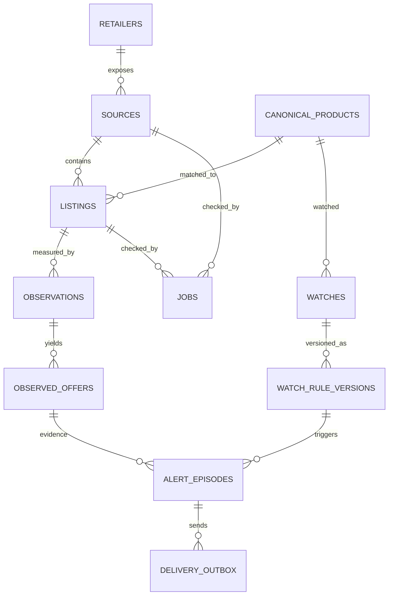

# leanPrice — Data Model, API and Domain Contracts
**Status:** Proposed v1 technical contract (not implemented)  
**Depends on:** merged [PRD](../product/PRD.md), [UX](../product/UX-SPEC.md), [Acceptance](../product/ACCEPTANCE.md) and [Architecture](ARCHITECTURE.md).  
**Source-of-truth rule:** changes in pricing/business meaning require product-document revision first.

## 1. Core invariants
1. **No floating point money.** ZAR amounts use INTEGER cents; display formatting is localized. External decimal strings parse with explicit locale or fail.
2. **No zero-price sale.** Price <=0, absent currency, ambiguous product or unassessed source cannot create a valid alert.
3. **Canonical product != retailer listing != observation != qualified offer.** These entities are separate with explicit foreign keys.
4. **No guess as known.** Stock/offer eligibility/confidence can be unknown. Unknown never becomes true during ranking.
5. **Immutable observation lineage.** A new collection creates a new attempt and observation; earlier history is not overwritten because a later parser fails.
6. **Every alert traces** to one validated observation, canonical match decision, rule version, eligible offer and notification episode.
7. **All user-supplied network targets are unsafe** until source approval and SSRF validation, including redirects and DNS re-resolution.
8. **One DB, local transactions.** Never hold write lock during HTTP or webhook call.
9. **Database schema changes are explicit, monotonic and tested** with fresh/upgrade/restore fixtures.

## 2. Domain entities and cardinalities


- `retailers`: brand identity (Clicks, Dis-Chem etc) without implying an adapter exists.
- `sources`: integration/locale-specific endpoint capability, review status and rate policy. A retailer may have different sources/sites.
- `canonical_products`: user-approved exact product identity.
- `listings`: specific URL/product SKU and match status to a canonical product; unconfirmed candidate may be unattached.
- `observations`: immutable attempt result with extraction facts, metadata and status, including errors.
- `observed_offers`: zero or more price/eligibility terms associated with successful observation.
- `watches`, `watch_rule_versions`: user intent and immutable rule logic versions.
- `alert_episodes`: deduped threshold/promotion event tied to verified offer.
- `delivery_outbox`: eventual delivery work/receipt.
- `jobs`: durable scheduled/adhoc tasks and leases, deduped keys.
- `source_events`, `match_reviews`, `admin_audit`: meaningful state transitions and manual decisions.
- `settings`, `admin_users`, `sessions`: private single-instance metadata and authentication.

## 3. Baseline DDL (design sketch, to finalize in migrations)
Types are SQLite primitives; IDs are opaque TEXT UUID/ULID unless justified otherwise, all timestamps UTC epoch milliseconds INTEGER, all prices INTEGER cents. The migration author must add CHECK and foreign-key constraints equivalent to those shown and test all indexes with query plans.

```sql
PRAGMA foreign_keys = ON;
PRAGMA journal_mode = WAL;

CREATE TABLE retailers (
  id TEXT PRIMARY KEY,
  name TEXT NOT NULL UNIQUE,
  enabled INTEGER NOT NULL DEFAULT 0 CHECK (enabled IN (0,1))
);
CREATE TABLE sources (
  id TEXT PRIMARY KEY,
  retailer_id TEXT NOT NULL REFERENCES retailers(id),
  source_key TEXT NOT NULL UNIQUE,
  base_host TEXT NOT NULL,
  locale TEXT NOT NULL DEFAULT 'en-ZA',
  currency TEXT NOT NULL DEFAULT 'ZAR',
  capability_json TEXT NOT NULL DEFAULT '{}',
  assessment_state TEXT NOT NULL DEFAULT 'unassessed'
    CHECK (assessment_state IN ('unassessed','approved','disallowed','paused','unsupported')),
  assessment_ref TEXT,
  assessment_at INTEGER,
  enabled INTEGER NOT NULL DEFAULT 0 CHECK (enabled IN (0,1)),
  min_interval_ms INTEGER NOT NULL DEFAULT 10000,
  next_allowed_at INTEGER NOT NULL DEFAULT 0,
  parser_version TEXT NOT NULL DEFAULT '0'
);
CREATE TABLE canonical_products (
  id TEXT PRIMARY KEY,
  display_name TEXT NOT NULL,
  brand TEXT, product_line TEXT, variant TEXT,
  quantity_numerator INTEGER,
  quantity_denominator INTEGER,
  quantity_unit TEXT,
  pack_count INTEGER NOT NULL DEFAULT 1 CHECK (pack_count > 0),
  gtin TEXT,
  archived INTEGER NOT NULL DEFAULT 0,
  created_at INTEGER NOT NULL, updated_at INTEGER NOT NULL
);
CREATE TABLE listings (
  id TEXT PRIMARY KEY,
  source_id TEXT NOT NULL REFERENCES sources(id),
  canonical_product_id TEXT REFERENCES canonical_products(id),
  external_sku TEXT,
  url TEXT NOT NULL,
  url_key TEXT NOT NULL,
  location_key TEXT NOT NULL DEFAULT '',
  match_state TEXT NOT NULL DEFAULT 'candidate'
    CHECK (match_state IN ('candidate','exact','possible','rejected','suspended')),
  match_reason TEXT,
  match_algorithm TEXT,
  first_seen_at INTEGER NOT NULL,
  last_checked_at INTEGER,
  UNIQUE (source_id, url_key, location_key)
);
CREATE INDEX idx_listings_product_match
  ON listings(canonical_product_id, match_state);
CREATE TABLE observations (
  id TEXT PRIMARY KEY,
  listing_id TEXT NOT NULL REFERENCES listings(id),
  job_id TEXT,
  observed_at INTEGER NOT NULL,
  fetch_status TEXT NOT NULL,
  http_status INTEGER,
  parser_version TEXT,
  evidence_digest TEXT,
  evidence_location TEXT,         -- JSON-LD path or selector, NOT full HTML
  observed_title TEXT,
  observed_gtin TEXT,
  observed_quantity_json TEXT,
  observed_stock TEXT NOT NULL DEFAULT 'unknown'
    CHECK (observed_stock IN ('in_stock','out_of_stock','unknown')),
  failure_code TEXT,
  source_url TEXT NOT NULL,
  validation_state TEXT NOT NULL
    CHECK (validation_state IN ('valid','invalid','uncertain')),
  CHECK (length(source_url) > 0)
);
CREATE INDEX idx_obs_latest ON observations(listing_id, observed_at DESC);
CREATE TABLE observed_offers (
  id TEXT PRIMARY KEY,
  observation_id TEXT NOT NULL REFERENCES observations(id),
  offer_kind TEXT NOT NULL CHECK
    (offer_kind IN ('standard','public_special','member','multibuy','coupon','unknown')),
  currency TEXT NOT NULL,
  amount_minor INTEGER NOT NULL CHECK (amount_minor > 0),
  original_claim_minor INTEGER,
  minimum_qty INTEGER NOT NULL DEFAULT 1 CHECK (minimum_qty > 0),
  membership_label TEXT,
  coupon_condition TEXT,
  valid_from INTEGER, valid_until INTEGER,
  offer_evidence TEXT NOT NULL,
  eligibility_state TEXT NOT NULL
    CHECK (eligibility_state IN ('public','conditional','unknown')),
  CHECK (valid_until IS NULL OR valid_from IS NULL OR valid_until >= valid_from)
);
CREATE INDEX idx_offers_by_observation ON observed_offers(observation_id);
CREATE TABLE watches (
  id TEXT PRIMARY KEY,
  canonical_product_id TEXT NOT NULL REFERENCES canonical_products(id),
  listing_id TEXT REFERENCES listings(id),
  active INTEGER NOT NULL DEFAULT 1 CHECK (active IN (0,1)),
  created_at INTEGER NOT NULL,
  current_rule_version INTEGER NOT NULL DEFAULT 1
);
CREATE TABLE watch_rule_versions (
  watch_id TEXT NOT NULL REFERENCES watches(id),
  version INTEGER NOT NULL,
  target_minor INTEGER CHECK (target_minor > 0),
  drop_basis_points INTEGER CHECK (drop_basis_points BETWEEN 1 AND 9900),
  condition_operator TEXT NOT NULL DEFAULT 'any'
    CHECK (condition_operator IN ('any','all')),
  allow_member INTEGER NOT NULL DEFAULT 0 CHECK (allow_member IN (0,1)),
  allow_multibuy INTEGER NOT NULL DEFAULT 0 CHECK (allow_multibuy IN (0,1)),
  rearm_policy_json TEXT NOT NULL DEFAULT '{}',
  created_at INTEGER NOT NULL,
  PRIMARY KEY (watch_id, version)
);
CREATE TABLE jobs (
  id TEXT PRIMARY KEY,
  job_kind TEXT NOT NULL,
  source_id TEXT REFERENCES sources(id),
  listing_id TEXT REFERENCES listings(id),
  dedupe_key TEXT NOT NULL UNIQUE,
  status TEXT NOT NULL
    CHECK (status IN ('queued','leased','retry_at','completed','blocked','dead')),
  attempt_count INTEGER NOT NULL DEFAULT 0,
  due_at INTEGER NOT NULL,
  lease_until INTEGER,
  leased_by TEXT,
  last_error_code TEXT,
  created_at INTEGER NOT NULL, updated_at INTEGER NOT NULL
);
CREATE INDEX idx_jobs_due ON jobs(status, due_at);
CREATE TABLE alert_episodes (
  id TEXT PRIMARY KEY,
  watch_id TEXT NOT NULL REFERENCES watches(id),
  rule_version INTEGER NOT NULL,
  observed_offer_id TEXT NOT NULL REFERENCES observed_offers(id),
  episode_key TEXT NOT NULL UNIQUE,
  reason_code TEXT NOT NULL,
  created_at INTEGER NOT NULL,
  closed_at INTEGER,
  FOREIGN KEY(watch_id,rule_version)
    REFERENCES watch_rule_versions(watch_id,version)
);
CREATE TABLE delivery_outbox (
  id TEXT PRIMARY KEY,
  alert_episode_id TEXT NOT NULL REFERENCES alert_episodes(id),
  destination_key TEXT NOT NULL,
  idempotency_key TEXT NOT NULL UNIQUE,
  status TEXT NOT NULL
    CHECK (status IN ('pending','leased','retry_at','delivered','dead')),
  attempt_count INTEGER NOT NULL DEFAULT 0,
  next_attempt_at INTEGER NOT NULL,
  last_status_code INTEGER,
  last_error_code TEXT,
  delivered_at INTEGER,
  UNIQUE (alert_episode_id, destination_key)
);
```

This is **not executable production-ready schema**: constraints, admin/session/event tables, storage paths, online-migration behavior, indexes and migration numbering must be finalized and reviewed slice-by-slice. In particular, avoid an outbox job whose status can become inconsistent with a source `job`; transactional boundaries must be explicit.

## 4. Normalized extraction contract
A fetcher returns an immutable bounded payload metadata object; adapter parsing never performs network calls behind a handler's back. Every parser returns an extraction *plus* per-field origin and warnings.

```go
type ExtractedPrice struct {
    Currency          string
    AmountMinor       int64
    Kind              OfferKind
    OriginalClaimMinor *int64
    MinPurchaseQty    uint32
    Membership        *string
    ValidFrom, ValidTo *time.Time
    EvidencePath      string
}
type Extraction struct {
    ObservedAt        time.Time
    SourceURL         string
    Title, Brand      string
    Variant, GTIN     string
    Quantity          Quantity
    Stock             StockState
    Offers            []ExtractedPrice
    Confidence        Confidence
    ParserVersion     string
    EvidenceDigest    string
    Warnings          []ErrorCode
}
```

Price precedence is not hard-coded globally: adapter supports explicit field origin metadata; inconsistent markup triggers a `PRICE_CONFLICT` rather than choosing lowest. Avoid storing raw HTML indefinitely; sanitized fixtures committed only where rights allow. PII and secrets never enter evidence fields.

## 5. URL and identity
**URL key:** normalize safe public URL form (lowercase/IDNA host, remove fragment, standard port, normalize recognized tracking parameters cautiously without deleting SKU-identifying params). Redirects must be revalidated; no vanity canonical URL redirect to internal host. Source host allowlist must include configured legitimate CDN subhosts only after assessment, not `*.retailer.com` by default.

**Match ordering:**
1. Check source identity and listing URL key.
2. GTIN exact when present and known trustworthy; reject conflict with size/brand.
3. Normalized brand/product-line/variant, quantity dimension/value/pack and known SKU.
4. Hard mismatch → rejected; insufficient fields → possible; high-confidence exact only with no hard conflict.
5. Manual match confirmation persists reviewer identity/time/rationale; changes audit and can trigger re-evaluation without retroactively mislabelling old alerts.

**Quantity model:** numerator/denominator rational, dimension `volume|mass|count`, normalized base unit; e.g. 750ml = 750/1000 L. Pack count separate. Compare unit prices only within the same dimension and when full effective quantity known. Price per unit display uses deterministic decimal rounding; pricing/evaluation retains rational semantics.

## 6. Offer eligibility and ranking contract
The `observed_offers` row is **a declared offer**, not necessarily a verified eligible offer. Ranking service first filters:
- source approved/enabled, listing exact, observation validation valid, observed timestamp within configured freshness, allowed currency, price >0;
- no unresolved mismatch/conflicting extraction; validity dates not expired;
- stock = in_stock preferred, stock unknown in separate qualified group, out_of_stock excluded from default purchase recommendation;
- `eligibility_state=public` for default public-only comparison;
- user setting explicitly permits member/multibuy before those are considered.

Then compare integer effective basket totals. If source does not disclose shipping, taxes, fees or geographic context, label “online listed price; checkout may differ”; do not invent total landed cost.

**Discount semantics:**
- `threshold_met`: observed qualifying price <= configured cents target.
- `observed_decrease`: fresh validated new price lower than preceding valid comparable observation.
- `retailer_sale_claim`: retailer explicitly labels discount, unverified old amount if not independently observed.
- `historical_saving`: explicitly scoped past valid comparison, not standard MVP “special” badge.
- Alerts say exactly which condition fired.

## 7. Watch rule evaluation and deduplication
```text
new verified offer
 -> validate fresh / exact / scoped / eligible / in-date
 -> load immutable watch rule version
 -> evaluate target and/or percentage drop
 -> compare with previous same-context valid observation (if needed)
 -> determine episode state/re-arm policy
 -> insert unique alert episode + unique outbox delivery in one transaction
 -> asynchronous outbound delivery
```

Episode state persists across restarts. For percentage drops, comparison context must match location/eligibility/quantity, and missing baseline suppresses % rule with explicit reason. A rule change increments version; current queued deliveries retain their original rule version and evidence. The operator may suppress old deliveries if desired, but must be auditable.

**Exactly-once logical event, best-effort external delivery:** unique constraints prevent two episode records; provider can receive a duplicate if network response is lost. Stable `Idempotency-Key` (if provider supports it) plus event-id payload and dedup guidance prevent or explain repeats. Never promise mathematically exactly-once third-party delivery.

## 8. Jobs and scheduler semantics
`due_at` is UTC. Scheduler wakes at a bounded interval and selects due jobs under memory policy and source rate policy. A job lease is owned by random process instance ID and expires; interrupted work safely retries. Queue unique dedupe key includes job type + listing/source + schedule bucket, not only listing forever; on completion, recurring scheduler creates subsequent bucket. Attempt limits and jitter are configured; 429 Retry-After overrides default earliest retry. `dead` and `blocked` are visible and not silently discarded.

**Concurrency invariants:** manual checks coalesce with existing due job; atomic claim requires SQLite write transaction; fetch outside DB transaction; commit observation + source status, then evaluate events. Queue age/length constrained; bursts deferred or rejected with `429` UI feedback; no hidden goroutine per watched item.

## 9. Initial HTTP route contracts
HTML first. All endpoints other than login/setup/health require a session. External navigation is normal anchor with `rel="noopener noreferrer"`. HTMX POSTs carry CSRF; partials and non-HTMX paths share service validation.

| Route | Method | Auth | Behaviour |
|---|---|---|---|
| `/` | GET | yes | Dashboard full page or selected fragment |
| `/login` / `/logout` | GET/POST | appropriate | Login and logout; session rotation |
| `/setup` | GET/POST | one-use local setup | Initial admin and privacy configuration |
| `/search` | GET | yes | Local catalog R1; opt-in discovery R2 |
| `/products` | GET | yes | Paginated/filterable catalog |
| `/products/from-url` | POST | yes+CSRF | Validate URL; preview token; no immediate unconfirmed attach |
| `/products` | POST | yes+CSRF | Persist canonical product after review |
| `/products/{id}` | GET | yes | Product, offers and history |
| `/products/{id}/listings` | POST | yes+CSRF | Attach confirmed listing |
| `/listings/{id}/check` | POST | yes+CSRF | Enqueue bounded idempotent refresh, return 202/HTMX |
| `/products/{id}/watches` | POST | yes+CSRF | Save versioned watch criteria |
| `/deals` | GET | yes | Fresh eligible offers and recent deal episodes |
| `/activity` | GET | yes | Paginated event history |
| `/sources` | GET | yes | Capability/health and assessment |
| `/sources/{id}/pause` | POST | admin+CSRF | Pause source with audit |
| `/settings` | GET/POST | yes+CSRF for POST | Locale, resource, notification settings |
| `/settings/notifications/test` | POST | yes+CSRF | Explicit test delivery |
| `/admin/backups` | GET/POST | admin+CSRF | List/make backup, validate restore intent |
| `/health/live` | GET | LAN/no secrets | Process alive |
| `/health/ready` | GET | LAN/no secrets | DB/migrations ready |

**General responses:** 400 unsafe malformed requests; 401 no session; 403 policy forbidden; 404 absent; 409 stale version conflict; 422 domain validation; 429 backpressure/rate; 503 dependency/policy disabled. HTMX 422 returns form fragment with errors and focus; non-HTMX performs full render. Protect the setup route against remote first-user takeover.

For cross-component diagnostics, internal service results use typed codes rather than passing raw network exception strings into HTML.

## 10. Page viewmodels
`ProductCardVM`: exact display identity, safe image policy, watched state, count of current confirmed offers and latest check status.  
`OfferVM`: retailer/name, amount/currency, qualification, eligibility, stock, observation timestamp, age, link, evidence label, stale flag, unit price if comparable, excluded reason.  
`WatchVM`: rule summary, version, channel, last episode, re-arm criteria, enable state.  
`SourceHealthVM`: state, capabilities, assessment date, last success/failure, next allowed check.  
`JobVM`: queued/leased/backoff/blocked, last error code, due time, operator action.  
**Never** expose raw authorization tokens, browser cookies, full untrusted HTML, or unchecked destination URLs.

## 11. Error taxonomy and failure contract
| Code | Category | Public action |
|---|---|---|
| `SOURCE_NOT_APPROVED` | Policy | No fetch; explain assessment required |
| `URL_UNSAFE` | Security | Reject and audit; no retry |
| `HTTP_RATE_LIMIT` | Source | Backoff through Retry-After; no alerts |
| `HTTP_FORBIDDEN` | Source | Stop/backoff and operator review |
| `FETCH_TIMEOUT` | Network | Bounded retry; last price stale |
| `BODY_TOO_LARGE` | Resource | Abort safely; no parse/price |
| `PRODUCT_MISMATCH` | Identity | Candidate review; exclude exact ranking |
| `PRICE_MISSING` | Parser | No new price; keep history |
| `PRICE_CONFLICT` | Correctness | Manual parser review; no alerts |
| `OFFER_TERMS_UNKNOWN` | Eligibility | Exclude public best/alerts |
| `STOCK_UNKNOWN` | Availability | Qualified display, not confirmed in-stock |
| `DB_BUSY` | Storage | Bounded retry and operator alert after threshold |
| `RESOURCE_DEFERRED` | Runtime | Pause acquisition until below soft watermark |
| `NOTIFY_FAILED` | Delivery | Outbox retry and visible diagnostics |

## 12. Database operations and backup
- `PRAGMA foreign_keys=ON`; WAL configured at startup, autocheckpoint tested against SD/SSD behavior.
- Short write transactions; schema migration serialized before scheduler starts.
- Safe online backup, integrity verification, checksum manifest, atomic rename, restrictive permissions, tested restore *with container stopped*. Never copy the main `.sqlite` file alone while WAL active.
- On restore: validate schema version, checksum/integrity, create safety backup, stop jobs, swap atomically where possible, restart, verify readiness and no deduped alert corruption.
- On old-version upgrade: backup first, apply forward-only migrations and dry-run in local fixture; rollback is binary+restored DB, not ad hoc reverse SQL.
- Consider database size/reliability on Pi SSD; no high-frequency fsync without demonstrated benefit.

## 13. Observability and privacy
Keep structured internal events for errors and alert decisions, not raw store pages. Store evidence digests/selector paths and timestamps for parser diagnosis. Logs and exports scrub session tokens, webhook secrets, home-network addresses and retailer cookies. Retention settings cannot erase referenced alert evidence while active; purge safe partitions only with explicit user action.

## 14. Implementation-linked traceability
| Design area | PRD references | Acceptance references |
|---|---|---|
| Canonical products/listings/matching | FR-001–009 | AC-M*, U-02 |
| Observations/offers/ranking | FR-010–020 | AC-P* |
| Watches/episodes/outbox | FR-021–029 | AC-A* |
| Scheduler/sources/health | FR-030–040 | AC-S*, AC-O* |
| Security/SSRF/auth | NFR-009/011 | AC-X*, AC-M02 |
| Resource and SQLite | NFR-001–008/010/014 | AC-R*, AC-O* |
| UI/HTMX/mobile | UX-SPEC | U-01–U-10 |

Every implementation slice will cite these IDs and add a migration, test fixture and observability artifact where applicable.
